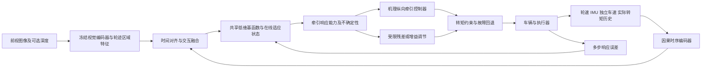

# 两段式感控一体：能力表征与机理–数据混合纵向牵引控制

> **范围与归属**：本路线基于已纳入的 01、02、03、05、06；04 已取消。下述网络、损失、控制接口和实验设计均为本整理提出的研究设想，尚未实现或验证，不是五篇论文共同完成的系统。创新性是相对这五篇的候选差异，仍需进一步查新，不能宣称全球首创。各篇原有成果见 [COMPARISON.md](COMPARISON.md) 和各精读文档。

## 1. 研究主张与可检验假设

核心主张：以低维、带置信度的**局部牵引响应能力**连接感知与控制，比单纯地形分类或要求每种地面完整标定更适合时空变化强的越野环境。这里的“能力”以一定状态与动作域内的未来响应定义，不声称是唯一的土壤材料参数。

| 可检验假设 | 原文依据 | 本研究新增部分 | 否证条件 |
|---|---|---|---|
| 视觉先验结合历史动力学可减少地形切换后的适应误差 | 01 视觉基函数+在线适应；02 元学习动力学更新 | 纵向转矩接口、多源历史融合及能力头 | 无视觉基线在跨地段测试同样好；视觉仅利用场景身份泄漏 |
| 低维在线更新能在有限激励下改善多步响应预测 | 01 线性参数适应；02 Kalman 适应基 | 带激励检测和置信度的能力适应 | 一步误差降低但滚动预测、控制均无改善 |
| 能力表征比单一 μ 更能处理模型失配 | 03 参数与模型局限；06 摩擦库依赖 | 扭矩响应、滑移响应、有效作用区间和不确定性联合输出 | 匹配容量的 μ/潜变量基线同样好，能力解释不稳定 |
| 受约束学习补偿提高牵引收益且避免转矩波动放大 | 05 基础策略+残差；06 增益调整和执行约束 | 直接残差转矩与增益调节的公平比较、不确定性门控 | 收益仅来自更大转矩或放宽约束，波动/风险显著恶化 |

## 2. 系统信号与第一段网络

**输入**：按轮保留轮速、转矩反馈、滑移估计、载荷估计与温度等可用通道；车身输入为纵向加速度、纵／侧向速度、横摆角速度、姿态及坡度估计。使用实际转矩或经过电流–转矩标定的估计，而不把饱和前命令当作真实作用。标明转矩观测的滤波延迟和误差；电机、传动效率和半径误差应独立建模，避免全归因于地形。

**视觉支路**：参考 01，先冻结预训练编码器，仅训练小型投影层；提取与左右轮迹对应的前方地面 patch，保留位置、时间戳与可见度掩码。相机看见的区域要按车速、相机外参和预计接触时间映射至轮下；通过人工遮挡、夜间与视动力学不一致场景检查其是否有用。

**历史支路**：使用因果 GRU/LSTM 或轻量 TCN，对最近一段实际输入和运动响应编码。输入长度从 0.2–1 s 的候选范围做验证选择，不把该范围写成已证实最优值。各通道显式提供缺测／时延掩码，必要时使用过去保持值；绝不使用部署时不可获得的未来状态。

**交互融合**：用轮迹视觉作为先验，历史响应作为校正信息；比较拼接 MLP 与小型交叉注意力，参数量和计算预算匹配。保留全车共享特征与逐轮特征，处理左右不同地形和车身耦合。不要为体现复杂度而默认采用大型端到端网络。

**输出层**：共享编码器输出低维基函数，在线仅更新最后线性组合或少量适应状态。第一版以 4/8/16 维候选比较，不预设维度越大越好。状态应同时接收不确定性校准与激励质量标志。

## 3. 中间能力表征的定义与边界

令 $h_t$ 表示截至当前的观测历史、$u$ 表示轮端实际转矩输入，以下为**本研究定义**，不是原论文公式：

$$
\hat x_{t+k}=\operatorname{Rollout}_k\!\left(f_{phys}+\Phi_\theta(h_t,x,u)a_t,\ x_t,\ u_{t:t+k-1}\right).\tag{R1}
$$

状态至少包括车身纵向速度和轮速；姿态／坡度可作为状态或外部估计。$f_{phys}$ 是独立的机理骨架，$\Phi_\theta a_t$ 是有效动力学修正，不直接命名为真实摩擦系数。先检查离散积分、单位、车轮惯量、转矩接口和采样率的一致性。

| 能力分量 | 拟议定义 | 用途 | 可验证程度 |
|---|---|---|---|
| 牵引响应 | 给定状态和短时可行动作下的纵向加速度／速度增量分布 | 判断转矩是否转化为车身加速 | 可用独立车速、IMU与实际转矩间接验证 |
| 转矩敏感性 | 预测模型在限定域的局部导数或有限差分 $\partial\hat a_x/\partial T_i$ | 调节控制增益、限幅及动作方向 | 需受控小扰动和激励覆盖；仅靠自然驾驶相关性不够 |
| 滑移响应 | 未来滑移变化及其对转矩扰动的响应 | 预判空转与恢复速度 | 依赖独立车速及低速分母处理 |
| 有效作用区间 | 在置信度、滑移和执行约束下可用的短时转矩区间 | 形成参考和约束 | 是局部控制能力，非完整牵引特性曲线 |
| 作用不确定性 | 预测分布方差／区间和分布外评分 | 决定补偿强度和回退 | 用校准曲线、覆盖率与尾部风险验证 |
| 低维潜状态 | 描述未建模作用的少量适应坐标 | 提供快速适应方向 | 无需每维都有唯一物理含义 |

敏感性要附带时间域、状态域和输入扰动幅值；静止、打滑饱和或缺乏激励时标记不可可靠估计。不能把一次模型梯度就当作测得的土壤物理斜率。坡度、滚阻、沉陷、电机迟滞和附着在仅有纵向加速度时可能相互混淆；应报告可预测的等效作用而非强行分解。

## 4. 元学习与在线自适应

**离线任务构造**：以地形片段、含水／松散程度、坡度、载荷、轮胎状态及执行器变化组成任务，不以离散路面类别作为唯一任务标签。同一连续行程只进入同一个数据分组；训练、验证、测试按完整地段／日期／地形组合划分，避免同一路段相邻样本泄漏。

**支持与查询**：支持窗口在前、查询窗口在后，训练时模拟真实在线适应过程。优化共享基函数、适应初值和噪声／遗忘参数；查询损失衡量适应后的多步预测而非仅支持集拟合。参考 02 的展开适应思想，但实现时要先解决其原文记号与协方差式疑点。

**在线**：起步先用保守名义控制器；有足够可靠响应后，以递推最小二乘或 Kalman 形式仅更新低维系数。维护正定协方差（可用 Joseph 形式并单元验证），限制更新速度和参数范围。变化点触发协方差膨胀／遗忘，不无条件清空所有知识。低激励、轮速失真或状态不可观测时暂停更新、扩大预测区间。

**候选训练目标（自行设计）**：

$$
\mathcal L=\sum_{k\in\mathcal H}w_k\lVert W(\hat x_{t+k}-x_{t+k})\rVert^2
+\lambda_a\mathcal L_{acc}+\lambda_{cal}\mathcal L_{calibration}
+\lambda_{phys}\mathcal L_{consistency}.\tag{R2}
$$

各项分别为多时域状态预测、加速度一致性、预测区间校准、机理一致性。各尺度须归一化，不令轮速量纲主导目标。物理一致性可让同一个预测轮地力同时进入车身与轮系方程，约束两类可观测响应相容；存在独立力测量时再增加力监督。若仅由同一转矩和轮角加速度反算力再回代转矩平衡，等式会恒等满足，不能构成额外约束或独立证据。不把无法测量的土壤参数真值作为硬标签。损失权重在验证集选取并做消融。

## 5. 不依赖逐地面完整标定的间接验证

**核心沿用 02 的思想**：在已记录的实际输入序列下，从同一初始状态进行多步开环 rollout，比较未来真实响应。建议多时域如 0.1、0.3、0.5、1.0 s，最终依小车速度和动态带宽确定。每个时域都报告误差分布，不能只挑最好的一步。

验证分成四层：

1. **观测一致性**：独立车速对轮速／滑移；姿态补偿 IMU 与速度差分的加速度；电机实际反馈对命令。先校验同步偏差，不能把延迟当作动力学残差。
2. **响应预测**：纵向速度、轮速、加速度和滑移的多步 RMSE／MAE及 95% 分位；报告切换后收敛时间、错误路面视觉先验下的恢复，以及预测区间覆盖率／宽度。teacher forcing 与真正滚动预测分别报告。
3. **局部敏感性**：在安全稳定支内对转矩作小幅正负扰动；重复、随机化次序并控制初始速度、载荷和坡度，用差分响应检查模型的方向和幅度。不得仅凭离线相关性声称因果敏感性。
4. **闭环效用**：在同一车速需求、约束、参考及传感条件下替换中间表征，比较牵引性能、滑移风险和转矩平顺性。

**辨识性结论的上限**：相同运动响应可能由多组参数造成。预测误差小仅证明模型在所测输入域具有解释／预测能力；要主张物理唯一辨识，需额外证明激励条件、可观测性、参数映射单射性或独立力／土壤测量。该研究不以此为前提，也不隐藏该限制。

**避免离线验证偏差**：闭环数据中的动作和状态相关，旧控制器未访问的动作不能靠离线误差证明可靠。训练时加入安全的动作变化，评价动作覆盖率；对超出支持范围的候选动作提高不确定性并限制控制补偿。真实转矩序列用于回放预测，闭环规划时则使用包含执行器模型的候选指令，二者不能混淆。

## 6. 第二段：先选可解释基线，再比较两条学习分支

**机理基础**：轮转动与纵向力平衡，低速滑移正则化、转矩包络、变化率及总需求；先建立 PI/PID 或增益调度滑移控制，验证无学习情况下可重复运行。03 的当前 LPV 状态表示存在可控性限制，不能直接将其作为已成立的纵向控制模型；需重新选择滑移状态并检验可控性，或采用另一已验证控制骨架。

**分支 A：残差转矩**（借鉴 05 的残差组织原则，但不是其原接口）：

$$
T^{cmd}=\Pi_{\mathcal F(t)}\!\left(T^{base}+g(\Sigma_t)\,\Delta T_\psi(h_t,z_t)\right),
\quad \lVert\Delta T_\psi\rVert\le \Delta T_{lim}.\tag{R3}
$$

$z_t$ 在此专指第一段的低维能力／适应表征，区别于03的沉陷符号；$\Sigma_t$ 表示经验证集校准的预测不确定性摘要，并不自动等于物理参数协方差。$g$ 随不确定性增加而减小；其单调性、速率和上下界需明确定义。约束投影应作用于总转矩而非仅残差；考虑抗饱和、延迟、微分噪声和乘员可接受的 jerk。奖励惩罚不取代硬限幅。不能直接将 05 的加速度残差策略当作已验证的轮端转矩残差。

**分支 B：学习型增益调节**：参考 06，网络输出增益增量，PI/PID 高频闭环，参数／增量双约束，固定推理周期；第一段能力与不确定性加入状态。基线使用同一可行性层和执行器带宽，防止将“多了安全投影”的收益误归为“学得更好”。两条分支先分别评估，不在第一版同时叠加两种适应而失去可解释性。

**参考生成**：保留固定滑移和 μ-路面库基线；新方案在当前可信动作域内最大化预测纵向收益，同时约束滑移、转矩波动和置信区间上界。不为每种新地面建立完整最优滑移曲线。若力学／数据不足，退回较保守参考；不能声称无信息也能立即达到未知地面的全局最佳牵引点。

**安全与稳定性研究**：明确局部运行域、表示误差界、时变参数界、低速状态与延迟假设；对基线闭环推导 ISS/最终有界条件，再将有限幅残差或有界增益变化纳入分析。06 的 A1–A4 只是可借鉴形式，不是新控制器自动继承的证明。约束交集为空时设定优先级和降级，避免声称投影万能。车辆试验只部署冻结的策略，不在线随机探索。

## 7. CarSim 与小车验证路线

| 阶段 | 任务 | 必须交付的证据 | 局限 |
|---|---|---|---|
| 模型与回放 | 统一单位、时钟、转矩接口、车速估计，训练第一段 | 留出数据多步误差、敏感性方向、区间校准 | 暂不声称闭环优势 |
| CarSim/Simulink | 均匀、对开、突变、坡度、转向、载荷、执行器失配 | 同一约束下多基线、多个随机种子、统计区间 | 标准公路轮胎模型不等于可变形软土 |
| 软土补充 | 外接 Bekker–Wong/Chrono 或其他有证据的轮地模型 | 沉陷/阻力与轮速响应覆盖，跨模型测试 | 不将训练器同模型测试当作独立验证 |
| 硬件在环 | 实际控制器和驱动器、通信时延、掉帧、回退 | 计算 P50/P95/P99/最大时延、截止期违约率、故障恢复 | 周期设置不能替代耗时实测 |
| 小车 | 硬地、草地、砾石及过渡；受控坡度/载荷 | 同步实际转矩、轮速、IMU与独立速度；重复工况 | 不必逐种地面完整牵引标定，但需记录可重复环境条件 |

小车从低速低转矩和保守参考开始，逐步增加负载；每策略每工况建议至少 5 次作为首轮重复性设计，正式样本量由先导方差和目标效应决定。随机化控制器顺序，记录土壤被前车次扰动、温度、含水和电量；软地每次测试的重复铺设／轨迹偏移规则要一致。按试次而非高频样本计算置信区间，避免伪重复。

端点包括：达到目标速度时间、单位行程电能、滑移峰值及超限积分、纵向加速度跟踪、转矩变化率和波动、横摆偏差、降级触发率、预测误差、适应时间、推理耗时。牵引收益必须在同一驾驶需求及约束下比较，防止“简单断扭”用低滑移掩盖行驶能力下降。

## 8. 消融与公平对比矩阵

| 试验组 | 改变项 | 要回答的问题 |
|---|---|---|
| A0 机理控制 | 无学习 | 学习是否确有增益 |
| A1 状态历史，无视觉 | 关闭视觉，匹配容量 | 视觉是否增加可泛化信息 |
| A2 视觉，无历史交互 | 去历史/交互 | 动力学反馈是否纠正视觉歧义 |
| A3 普通预训练 vs 元学习 | 同数据与计算预算 | 元学习是否改善少样本适应 |
| A4 固定模型 vs 末层适应 | 编码器相同 | 在线变化是否必要 |
| A5 μ输出 vs 潜变量 vs 能力输出 | 相近容量与监督数据 | 能力接口是否优于分类/标量摩擦 |
| A6 一步损失 vs 多步损失 | 仅预测损失改变 | 多步预测是否改善闭环效用 |
| A7 无置信度门控 | 保留相同硬约束 | 不确定性是否减少分布外失效 |
| A8 残差转矩 vs 增益调节 | 同基线、约束和训练预算 | 两种补偿机制适用域是什么 |
| A9 去/有投影 | 仅仿真中做去约束消融 | 收益来自学习还是可行性处理 |
| A10 故障及视觉失真 | 转矩偏差、速度丢失、暗光、错误先验 | 能否检测并合理回退 |

必须包含未知地形组合、外观相同作用不同、外观不同作用相近、低激励／低速、坡度与附着混淆等测试。基线可包含 06 式 SAC-PID、非元学习 RLS 适应，以及小规模受约束预测控制；不将取消的 04 当作已经复现的 MPC 基线来源。

## 9. 推荐的最小研究闭环与后续扩展

先完成“轮速＋IMU＋独立车速＋实际转矩历史 → 低维残差响应 → 有界 PI/PID 增益或转矩补偿”，以跨地段多步预测和闭环效用建立可复现基线；再增加视觉先验和元学习，逐项消融。这样可以判断视觉、适应、控制约束分别解决了什么问题。

论文写作中的主要贡献应由证据限定为：控制导向能力定义、少数据在线适应、间接验证协议及受约束混合控制接口；只有实验和理论完成后才能写“优于”“稳定”“实时”。尚待核验事项见 [QUALITY_CHECK.md](QUALITY_CHECK.md)。
